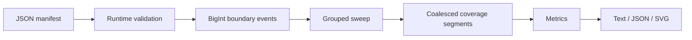

# Architecture and tradeoffs

`model.ts` validates an unknown value and converts decimal strings to BigInt.
`audit.ts` is pure: it accepts unknown input, validates it, and computes coverage
without file I/O or mutating the caller's objects. `format.ts` renders results.
`cli.mjs` owns bounded file reads, argument parsing, output publication, and
exit status. The core contains only erasable TypeScript, executed by Node.

## Sweep semantics

Each range contributes `+1` at its start and `-1` at its end. Add zero-delta
events at zero and at the target size, then sort by exact offset. Iterate over
events directly: emit the preceding span only when the offset advances, then
apply the current event's delta. Equal-offset events emit no span, so every delta
in a group is applied before describing the span to the next distinct offset.
This implements half-open intervals and avoids false overlaps between touching
ranges. Event ordering inside a group has no effect.

The resulting depth is constant between successive event positions. Adjacent
segments with equal depth are merged, even when their contributing range IDs
change. The result is a complete partition of the target with maximal runs of
equal depth. A zero-sized target has no segments and is vacuously exact.

For a segment of length L and depth D:

- Covered increases by L if D > 0; missing increases by L if D = 0.
- Overlap increases by L if D > 1.
- Redundant increases by `(D - 1) * L` if D > 1.

The submitted-length sum is computed independently from input ranges, giving
the invariant `submitted = covered + redundant`. The second invariant is
`total = covered + missing`. Metrics use BigInt throughout.

## Complexity and choices

For N ranges there are 2N+2 events. Sorting costs O(N log N) comparisons; the
sweep and metrics are O(N), with O(N) storage. BigInt arithmetic cost depends
on operand width, which this input contract caps at 30 digits per offset.
These are algorithmic bounds, not measured speed claims.

Reporting every owning ID for every span can produce quadratic output in a
deeply overlapping manifest. This version reports depth and offsets instead.
Range IDs provide input identity and duplicate detection but are not emitted
as ownership sets. An optional lookup or ownership mode would be a separate
extension with its own output-size limits.

The CLI reads at most 2 MiB plus one sentinel byte and rejects oversized files.
It stores the manifest and report in memory; it is not a streaming JSON parser.
Native JSON.parse's last-property-wins behavior is explicit rather than claiming
duplicate-property detection. Schema validation rejects unknown fields and
malformed byte strings after parsing.

SVG positions are derived by integer scaling of BigInt offsets into thousandths
of a display unit, then converting only that bounded pixel coordinate to Number.
The audit metrics are unaffected by pixel rounding. Very small segments can
be invisible, so SVG output is a visual overview with exact text/JSON alternatives.
Names are escaped before inclusion in XML/HTML. No scripts, assets, or telemetry
are embedded. Browser support for foreignObject is required for the wrapped name.

## File safety

Reports are created only after validation and analysis succeed. File output is
written in a fresh temporary directory beside the destination. An atomic hard
link then creates the destination path without replacement; competing writers
cannot silently overwrite each other. Temporary files are removed afterward.
The original input is never written. Hard-link support is required, and power
loss, exotic filesystem behavior, and concurrent input mutation are outside
the guarantee.

## Verification

The small-grid oracle counts coverage separately at each byte of a three-byte
target. There are six possible nonempty intervals on this grid. Giving each
interval multiplicity 0, 1, 2, or 3 produces **4^6 = 4,096** multisets. For each,
tests compare metrics and expanded segments with the oracle, check conservation
identities, and reverse input order to check invariance. The oracle does not
share the production event-sweep implementation.

Other tests target values beyond Number.MAX_SAFE_INTEGER, 30-digit boundaries,
coalescing, touching endpoints, repeated intervals, empty targets, invalid input,
SVG escaping, and competing file writers. Tests execute native TypeScript source
through Node's built-in test runner.

Separately, TypeScript 6.0.3 checks all three `src/**/*.ts` modules with `strict`,
`noUncheckedIndexedAccess`, `exactOptionalPropertyTypes`, and `erasableSyntaxOnly`.
The check emits no JavaScript; Node still executes the original source. The
compiler is the only development dependency, pinned in the lockfile. No Node
type declarations are needed because the typed core uses only ES2024 built-ins.
The JavaScript CLI, tests, and release scanner remain outside the static check.
Static checking complements runtime validation of untrusted JSON and the oracle;
it cannot prove the sweep's algorithmic correctness. CI runs both kinds of checks.

For an interview, explain why half-open ranges simplify boundaries, why counts
must not pass through JSON numbers, how overlap differs from redundancy, and
which complexity tradeoff avoids emitting all owner sets. Be accurate about AI
assistance, review, and later personal modifications.
